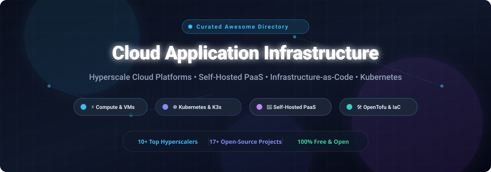
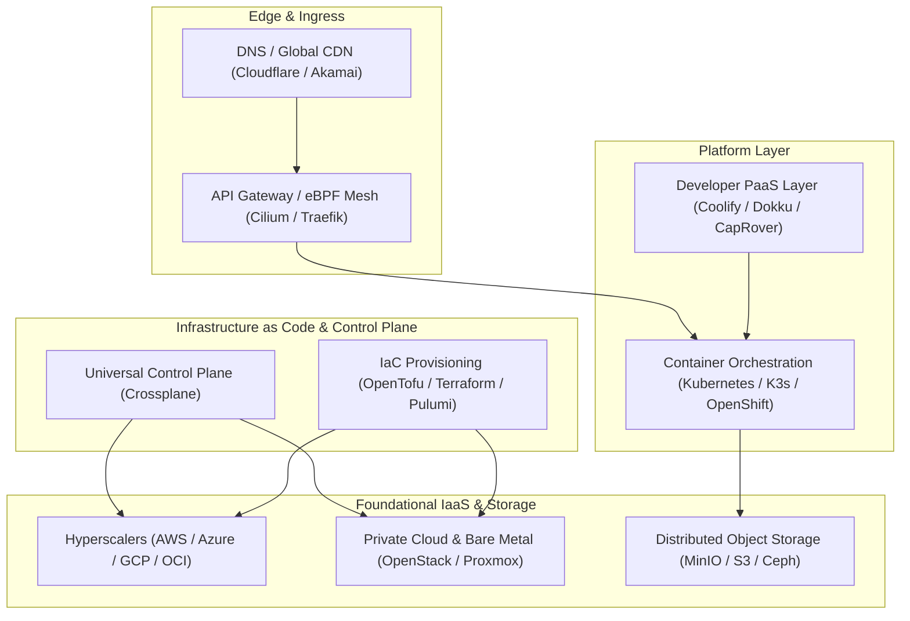

# ☁️ Awesome Cloud Application Infrastructure

  
  
  
  
  
  

**A curated, production-tested directory of leading Cloud Application Infrastructure SaaS platforms and open-source GitHub projects.**  
*Covering compute, distributed storage, serverless runtimes, eBPF networking, and cloud platform engineering tools.*

---

## 📑 Table of Contents

- [📊 Sector Overview & Market Dynamics](#-sector-overview--market-dynamics)
- [🏢 SaaS & Hosted Cloud Platforms](#-saas--hosted-cloud-platforms)
- [💻 Open-Source Cloud Infrastructure Projects](#-open-source-cloud-infrastructure-projects)
- [🏗️ Architecture Blueprint](#️-architecture-blueprint)
- [🤝 How to Contribute](#-how-to-contribute)
- [⭐ Star History](#-star-history)
- [💖 Support & Sponsorship](#-support--sponsorship)
- [⚖️ Disclaimer](#️-disclaimer)

---

## 📊 Sector Overview & Market Dynamics

The global cloud infrastructure services (IaaS/PaaS) market is estimated at **$290+ billion in 2024–2025** and projected to surpass **$650+ billion by 2030** (CAGR ~17–20%), propelled by enterprise modernization, cloud-native architectures, and generative AI workloads. 

The sector remains **highly concentrated**, characterized by an oligopoly where the "Big Three" hyperscalers (AWS, Microsoft Azure, and Google Cloud) control roughly 65% of global market share, while regional specialists, European sovereign clouds, and developer-centric PaaS/IaaS providers contest the remaining market segments with specialized performance, compliance, and predictable cost structures.

---

## 🏢 SaaS & Hosted Cloud Platforms

Below is a comparison of top cloud application infrastructure SaaS & hosted platforms, ordered by **Company Scale (Market Cap / Valuation / Revenue)** descending:

| Product | 📈 Scale (Valuation / Market Cap / Rev) | 📝 Description | 💵 Starting Pricing | 🎁 Free Tier / Trial Limits |
|:--------|:-------------------------------------|:------------|:-----------------|:-------------------------|
| **[Microsoft Azure](https://azure.microsoft.com/)** | ~$3.1T Market Cap (~$110B+ Cloud Run-Rate) | Enterprise-grade global hyperscaler with native integration across Active Directory, Microsoft 365, GitHub, and hybrid management via Azure Arc. | B1s Linux VM from ~$0.0116/hour; Blob Storage from $0.018/GB/month | **12 Months Free**: 750 hrs B1s VM, 5GB Blob Storage, 55+ always-free services; $200 credits for 30-day trial |
| **[Amazon Web Services (AWS)](https://aws.amazon.com/)** | ~$2.2T Market Cap (Amazon parent; AWS ~$105B+ ARR) | Market-share leader in public cloud computing offering 200+ managed services spanning compute (EC2), object storage (S3), relational databases (RDS), and serverless (Lambda). | t3.micro Linux EC2 from ~$0.0104/hour; S3 Standard from $0.023/GB/month | **12 Months Free**: 750 hrs/month t2.micro/t3.micro, 5GB S3, 750 hrs RDS; $200 promotional credits upon signup |
| **[Google Cloud Platform (GCP)](https://cloud.google.com/)** | ~$2.1T Market Cap (Alphabet parent; GCP ~$40B+ ARR) | Hyperscale infrastructure engineered for big data analytics (BigQuery), Kubernetes (GKE), serverless containers (Cloud Run), and AI/ML (Vertex AI). | e2-micro VM from ~$0.0104/hour; Standard Cloud Storage from $0.020/GB/month | **Always Free**: 1 e2-micro instance (US regions), 5GB storage, 1GB BigQuery queries/month; $300 credit for 90-day trial |
| **[Oracle Cloud Infrastructure (OCI)](https://www.oracle.com/cloud/)** | ~$480B Market Cap (~$7B+ IaaS/PaaS ARR) | High-performance enterprise cloud known for bare-metal compute, Autonomous Database clusters, and generous resource allocations. | VM.Standard.E4.Flex from ~$0.0075/hour; Block Volumes from $0.0255/GB/month | **Always Free**: 2 AMD VMs (1/8 OCPU, 1GB RAM each), 4 Arm Ampere A1 cores + 24GB RAM, 200GB block storage, 10GB object storage, 2 Autonomous DBs; $300 credit for 30 days |
| **[Alibaba Cloud](https://www.alibabacloud.com/)** | ~$220B Market Cap (Alibaba Group; ~$15B+ Cloud ARR) | Largest APAC cloud provider offering elastic computing, database management, and low-latency connectivity across Asian and global business centers. | ECS t5-lc1m1.small from ~$0.012/hour; OSS object storage from $0.018/GB/month | **Free Trial**: $300–$1,200 promotional credits (region-dependent) + 12-month free access to select starter tiers |
| **[IBM Cloud](https://www.ibm.com/cloud)** | ~$200B Market Cap (~$20B+ Hybrid Cloud Revenue) | Enterprise and hybrid multi-cloud platform optimized for regulated environments, mainframe integration, AI (Watsonx), and Red Hat OpenShift clusters. | bx2-2x8 Virtual Server from ~$0.047/hour; Cloud Object Storage from $0.023/GB/month | **Lite Plan**: Always-free 25GB object storage, 500MB Cloudant NoSQL database, single-node test cluster; $200 credit valid 30 days |
| **[Linode (Akamai)](https://www.linode.com/)** | ~$15B Market Cap (Akamai Technologies parent) | Developer-friendly cloud hosting platform backed by Akamai's global edge network, offering flat and transparent pricing for core compute. | Nanode 1GB RAM VM from $5/month; Block Storage from $0.10/GB/month | **Free Trial**: $100 credit valid for 60 days across compute and storage instances (no perpetual free VM tier) |
| **[Freshworks Cloud Infrastructure](https://www.freshworks.com/)** | ~$4B Market Cap (~$700M ARR) | Enterprise SaaS business application suite providing customer engagement and IT service management running on multi-tenant managed cloud infrastructure. | Freshdesk from $19/agent/month; Freshservice from $23/agent/month | **Free Plan**: Freshdesk free up to 2 agents with unlimited ticket management; 14-to-21-day full enterprise feature trial |
| **[DigitalOcean](https://www.digitalocean.com/)** | ~$3.5B Market Cap (~$750M ARR) | Intuitive cloud services platform catering to indie developers, software agencies, and high-growth startups requiring fast provisioning. | Basic Droplet (512MB RAM, 1 vCPU, 10GB SSD) from $4/month; Spaces from $5/month | **Free Trial**: $200 credit valid for 60 days across Droplets, managed Kubernetes, and databases (no perpetual free VM tier) |
| **[OVHcloud](https://www.ovhcloud.com/)** | ~$1.8B Market Cap (~$1.1B Annual Revenue) | European cloud and bare-metal leader providing sovereign data infrastructure, compliant public cloud instances, and hosted private clouds. | Value VPS from ~$3.50/month; Public Cloud instances from ~$0.0087/hour | **Free Trial**: €100–€200 cloud promotional credit vouchers valid for 30 days via introductory promotional onboarding |

---

## 💻 Open-Source Cloud Infrastructure Projects

A collection of top open-source cloud application infrastructure frameworks, container orchestrators, infrastructure-as-code engines, and self-hosted PaaS stacks, ranked by **GitHub Star Count** descending:

| Project | ⭐ GitHub Stars | 🎯 Focus Area | 📖 Description |
|:--------|:-------------|:-----------|:------------|
| **[Kubernetes](https://github.com/kubernetes/kubernetes)** |  | Container Orchestration | Automated deployment, scaling, and operational management of containerized applications; the standard backbone of modern cloud platform engineering. |
| **[Ansible](https://github.com/ansible/ansible)** |  | Automation & Config Mgmt | Radically simple IT automation system handling configuration management, application deployment, cloud provisioning, and ad-hoc task execution. |
| **[Coolify](https://github.com/coollabsio/coolify)** |  | Self-Hosted PaaS | Self-hostable, all-in-one alternative to Heroku/Netlify/Vercel; deploy applications, databases, and Docker containers across your own servers. |
| **[MinIO](https://github.com/minio/minio)** |  | High-Performance Object Storage | S3-compatible high-performance object storage server designed for cloud-native AI/ML workloads, Kubernetes deployments, and hybrid clouds. |
| **[Terraform](https://github.com/hashicorp/terraform)** |  | Infrastructure-as-Code | Declarative infrastructure-as-code engine enabling engineers to provision and version multi-cloud architecture across hundreds of providers. |
| **[K3s](https://github.com/k3s-io/k3s)** |  | Lightweight Kubernetes | Highly available, certified lightweight Kubernetes distribution packaged as a single binary; ideal for edge computing, IoT, ARM, and CI environments. |
| **[Dokku](https://github.com/dokku/dokku)** |  | Docker-Powered PaaS | The smallest PaaS implementation you've ever seen; Docker-powered single-host application deployment platform via `git push`. |
| **[OpenTofu](https://github.com/opentofu/opentofu)** |  | Open-Source IaC | Community-driven, open-source fork of Terraform governed under the Linux Foundation (MPL-2.0 licensed). |
| **[Rancher](https://github.com/rancher/rancher)** |  | Multi-Cluster K8s Management | Complete software stack for teams adopting containers; manages multiple Kubernetes clusters across on-premises bare metal and public clouds. |
| **[Pulumi](https://github.com/pulumi/pulumi)** |  | Code-First IaC | Developer-centric infrastructure-as-code platform supporting standard languages including TypeScript, Python, Go, C#, and YAML. |
| **[Cilium](https://github.com/cilium/cilium)** |  | Cloud-Native eBPF Networking | eBPF-based networking, observability, and network security for container workloads and Kubernetes service mesh architectures. |
| **[CapRover](https://github.com/caprover/caprover)** |  | Automated PaaS | Easy-to-use self-hosted PaaS and container manager for NodeJS, Python, PHP, Ruby, and Docker apps with free SSL automation. |
| **[Crossplane](https://github.com/crossplane/crossplane)** |  | Universal Control Plane | CNCF framework transforming Kubernetes into a universal control plane to orchestrate infrastructure, cloud services, and custom internal platforms. |
| **[OpenStack](https://github.com/openstack/openstack)** |  | Private Cloud IaaS | Complete open-source cloud computing fabric for bare metal, virtual machines, and software-defined storage and networking. |
| **[Apache CloudStack](https://github.com/apache/cloudstack)** |  | Multi-Hypervisor IaaS | Turnkey open-source cloud computing software designed to deploy and manage large networks of virtual machines as highly scalable IaaS. |
| **[OpenShift (OKD)](https://github.com/openshift/okd)** |  | Enterprise Kubernetes PaaS | The origin community distribution of Red Hat OpenShift optimized for continuous developer tooling, container build pipelines, and cluster operations. |
| **[Cloud Foundry](https://github.com/cloudfoundry/cf-deployment)** |  | Cloud Application Platform | Mature open-source platform-as-a-service enabling development teams to build, test, and deploy applications across multiple clouds with zero lock-in. |

---

## 🏗️ Architecture Blueprint

---

## 🤝 How to Contribute

We welcome additions, corrections, and improvements from DevOps practitioners, platform engineers, and open-source maintainers:

1. **Fork the repository** to your GitHub account.
2. **Add or edit entries** in `README.md` keeping formatting, accurate pricing, free tier details, and stargazer badges consistent.
3. Ensure open-source projects are placed in the table corresponding to their star count order.
4. **Submit a pull request** outlining the suggested changes and linking authoritative references.

---

##  Star History

---

## 💖 Support & Sponsorship

Thank you so much for exploring and using this curated cloud infrastructure directory! 🌟

If you find this repository valuable for your projects, architecture planning, or engineering teams, please consider supporting the project:

- ⭐ **Star this repository** on GitHub to increase visibility.
- 🍴 **Fork and share** it with fellow DevOps engineers, platform architects, and developers.
- ☕ **Buy me a coffee / Sponsor**: Support ongoing maintenance, updates, and research via the [GitHub Sponsors Dashboard](https://github.com/sponsors/ishandutta2007).

Every contribution and share helps keep this resource accurate, comprehensive, and up-to-date!

---

## ⚖️ Disclaimer

- This list is independently curated by the community for educational and architecture-evaluation purposes. It is not sponsored by or affiliated with any cloud provider.
- Cloud infrastructure pricing, promotional credit amounts, and free tier quotas change frequently. Always consult the respective vendor's official pricing calculator before provisioning production systems.

---

  Curated with precision for platform engineers, DevOps professionals, site reliability engineers (SREs), and cloud architects.

